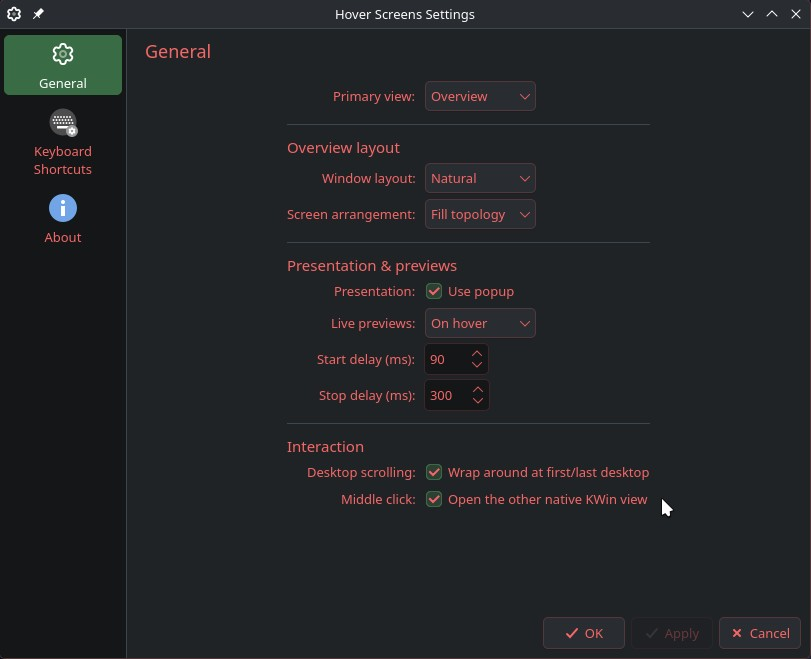
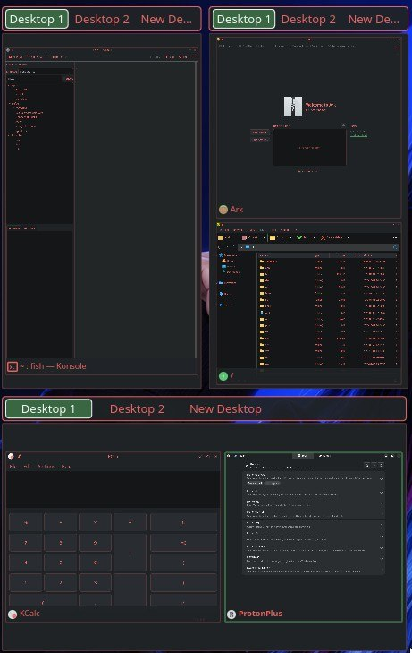

# Hover Screens

Hover Screens is a KDE Plasma 6 widget that provides live miniature views of
windows across physical monitors and virtual desktops.

It has two primary views:

- **Overview** — shows the current virtual desktop of each physical output.
- **Grid View** — browses virtual desktops, grouped either by desktop or by
  physical screen.

Hover Screens is designed for Plasma/Wayland and uses Plasma TaskManager and
PipeWire for previews. Exact per-output virtual-desktop switching is handled by
a small bundled KWin JavaScript companion.

## Screenshots

| | |
| --- | --- |
|  |  |
|  |  |

## Requirements

- KDE Plasma **6.4+**
- KWin / Wayland
- Plasma TaskManager QML module
- KDE PipeWire QML module

Developed and live-tested on Plasma 6.7.x.

## Installation

Hover Screens requires **KDE Plasma 6.4 or newer on Wayland**. PipeWire and the
KDE PipeWire QML module must be available for live previews. Packages include
both the **Plasmoid** and the **KWin companion**; do not install either
separately when using a distro package.

Download release files from the project's GitHub **Releases** page. Install only
one variant (a distro package or the local component archives), not both.

### Local - new

For a user-local installation without `sudo`, download the matching `.plasmoid`
and `.kwinscript` release assets. From the directory containing them:

```
kpackagetool6 -t Plasma/Applet -i ./Hover_Screens-1.0.1.plasmoid
kpackagetool6 -t KWin/Script -i ./Hover_Screens-Companion-1.0.0.kwinscript
```

Enable **Hover Screens Companion** in **System Settings - Window
Management - KWin Scripts**. If KWin does not activate it immediately, sign
out and back in.

Restart Plasma Shell after installation or updating:

```
systemctl --user restart plasma-plasmashell.service
```

Alternatively, enable it from a terminal:

kwriteconfig6 --file kwinrc --group Plugins \
  --key io.github.suppdiff.hoverscreens.companionEnabled true
qdbus6 org.kde.KWin /KWin reconfigure

### Local - If updating.

```
kpackagetool6 -t Plasma/Applet -u ./Hover_Screens-1.0.1.plasmoid
kpackagetool6 -t KWin/Script -u ./Hover_Screens-Companion-1.0.0.kwinscript
```

### Arch

Download `plasma6-applets-hover-screens-1.0.1-<pkgrel>-any.pkg.tar.zst`

```
sudo pacman -U ./plasma6-applets-hover-screens-1.0.1-*.pkg.tar.zst
```

Enable **Hover Screens Companion** in **System Settings - Window
Management - KWin Scripts**. If KWin does not activate it immediately, sign
out and back in.

Restart Plasma Shell after installation or updating:

```
systemctl --user restart plasma-plasmashell.service
```

Alternatively, enable it from a terminal:

kwriteconfig6 --file kwinrc --group Plugins \
  --key io.github.suppdiff.hoverscreens.companionEnabled true
qdbus6 org.kde.KWin /KWin reconfigure

### Debian/Ubuntu

Download `plasma6-applets-hover-screens_1.0.1-1_all.deb`

```
sudo apt install ./plasma6-applets-hover-screens_1.0.1-1_all.deb
```

Enable **Hover Screens Companion** in **System Settings - Window
Management - KWin Scripts**. If KWin does not activate it immediately, sign
out and back in.

Restart Plasma Shell after installation or updating:

```
systemctl --user restart plasma-plasmashell.service
```

Alternatively, enable it from a terminal:

kwriteconfig6 --file kwinrc --group Plugins \
  --key io.github.suppdiff.hoverscreens.companionEnabled true
qdbus6 org.kde.KWin /KWin reconfigure

**Note:** Debian releases with an older KDE Plasma version do not meet the
runtime requirement, even if the package format is supported.

### Fedora

On a Fedora KDE Plasma 6.4+ installation, download the matching `.rpm` asset:

```
sudo dnf install ./plasma6-applets-hover-screens-1.0.1-1*.noarch.rpm
```

Enable **Hover Screens Companion** in **System Settings - Window
Management - KWin Scripts**. If KWin does not activate it immediately, sign
out and back in.

Restart Plasma Shell after installation or updating:

```
systemctl --user restart plasma-plasmashell.service
```

Alternatively, enable it from a terminal:

kwriteconfig6 --file kwinrc --group Plugins \
  --key io.github.suppdiff.hoverscreens.companionEnabled true
qdbus6 org.kde.KWin /KWin reconfigure

### Swapping from local install to a package

If Hover Screens was previously installed locally with `kpackagetool6`, remove the local copies before installing a distro package:

```
kpackagetool6 -t Plasma/Applet -r io.github.suppdiff.hoverscreens
kpackagetool6 -t KWin/Script -r io.github.suppdiff.hoverscreens.companion
```

Then install the Arch, Debian/Ubuntu, or Fedora package normally.

This prevents a copy under `~/.local/share/` from taking precedence over the system package under `/usr/share/`.

Existing Hover Screens widget settings are normally preserved.

## Uninstallation

### Local installation

Remove both components:

```
kpackagetool6 -t Plasma/Applet -r io.github.suppdiff.hoverscreens
kpackagetool6 -t KWin/Script -r io.github.suppdiff.hoverscreens.companion

systemctl --user restart plasma-plasmashell.service
```

### Arch / CachyOS

```
sudo pacman -R plasma6-applets-hover-screens
```

### Debian / Ubuntu

```
sudo apt remove plasma6-applets-hover-screens
```

### Fedora

```
sudo dnf remove plasma6-applets-hover-screens
```

## Features

### Overview

Window layouts:

- **Natural** — aspect-aware non-overlapping packing; default.
- **Reflow** — balanced grid packing.
- **Horizontal** — one row.
- **Vertical** — one column.
- **Spatial** — preserves real window positions and physical monitor topology.
- **Adaptive** — chooses an appropriate packed layout from available geometry.

Screen arrangement:

- **Fill topology** — fills the available widget area; non-Spatial monitor cards
  may stretch with the available geometry.
- **Adaptive** — preserves each monitor card's physical aspect ratio and repacks
  screens according to the available widget shape.

Adaptive screen arrangement fits rows independently, so portrait screens can
remain large while a wide landscape row uses a shorter height when appropriate.
Spatial always keeps the real physical monitor topology.

Each physical screen has its own virtual-desktop control. At normal sizes the
desktop strip stays outside the window surface; at cramped heights it becomes a
small non-interactive active-desktop indicator so previews keep the available
space.

Desktop controls:

- click a desktop chip → switch that exact physical output
- vertical wheel over a strip or screen pane → previous/next desktop
- Shift+wheel or horizontal wheel over an overflowing strip → pan the strip
- optional wrapping at the first/last desktop

### Grid View

Grid uses the same per-screen renderer as Overview.

Window layouts:

- Natural
- Reflow
- Horizontal
- Vertical
- Spatial
- Adaptive

Grouping:

- **By desktop** — each virtual desktop contains its physical-screen previews.
- **By screen** — each physical screen contains that screen's virtual desktops.

Desktop arrangement:

- **Follow KDE layout** — respects KDE's configured desktop row layout.
- **Adaptive** — presentation-only packing chosen from available geometry.

By-screen desktop miniatures preserve the physical monitor aspect ratio and stay
tightly grouped. Screen groups follow physical virtual-desktop position.

Clicking an empty screen/desktop miniature changes only that exact physical
output to that desktop. Window previews keep their normal window activation.

### Live previews

Live preview modes:

- **On hover**
- **Always**
- **Off**

On-hover start and stop delays are configurable. Preview capture is
lifetime-gated rather than polled continuously.

## Architecture

Overview and Grid share one per-screen renderer:

```
OverviewScreen                         GridScreenSurface
     │                                        │
     └──────────────┐          ┌──────────────┘
                    ▼          ▼
                 ScreenLayoutSurface
                    │
            ┌───────┴────────┐
            ▼                ▼
 OverviewWindowLayout   ScreenSpatialWindow
```

`ScreenLayoutSurface.qml` is the authoritative per-screen layout renderer.
Overview and Grid differ primarily in how their TaskManager models are filtered
and how navigation is presented.

The KWin companion has a deliberately narrow responsibility:

- set one output to one numbered virtual desktop
- step one output to the previous/next desktop
- publish exact per-output desktop state through KGlobalAccel's existing D-Bus
  shortcut signal

It does **not** poll, run shell commands, expose arbitrary JavaScript, or
manipulate windows.

## Security notes

- no shell execution from QML or the KWin companion
- no polling daemon
- no cookie, session, or token access
- per-output desktop actions use a defined KGlobalAccel naming scheme
- only normalized native action names are accepted by the plasmoid

## License

Hover Screens is licensed under **GPL-3.0-or-later**.

See [LICENSE](LICENSE) for the full GNU General Public License version 3 text.
